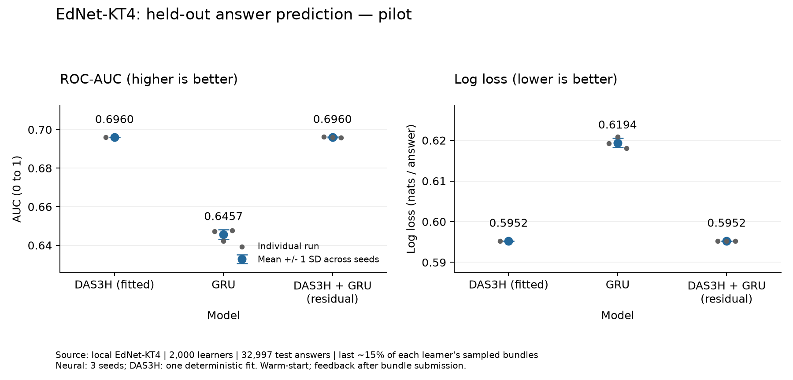

# Kết quả thử nghiệm DAS3H, GRU và kết hợp trên EdNet

Ngày chạy: 17/10/2026. Đây là kết quả thực nghiệm trên mẫu EdNet thật, không phải số liệu từ bài báo.

## Kết quả chính

- Mô hình có log loss test trung bình thấp nhất trong thiết lập này: **DAS3H (fitted)**.
- Hybrid so với DAS3H: chênh AUC trung bình +0.000071; chênh log loss trung bình +0.000016.
- Kết quả này chỉ áp dụng cho cấu hình và mẫu đã chạy; xem độ bất định và giới hạn bên dưới.

## Dữ liệu và phương pháp

- 2,000 học viên; 192,952 nhóm câu đã nộp; 209,708 lượt trả lời.
- Train: 144,908; validation: 31,803; test: 32,997.
- Chia theo thời gian trong từng học viên, giữ nguyên nhóm câu. Không đưa đáp án trong cùng nhóm vào dự đoán.
- DAS3H học trọng số từ train; GRU và hybrid chạy seed 11/22/33. Chọn C/epoch bằng validation log loss.
- Hybrid ở đây là DAS3H đã fit và đóng băng, cộng phần hiệu chỉnh logit do GRU học; không phải tái lập RKTM.
- Tỷ lệ đúng trên test: 65.04%; luôn đoán đúng cho mọi câu đạt accuracy 65.04%, AUC 0.5.
- Test có 398 lượt trả lời cho câu chưa xuất hiện trong train; 14,451 lượt có nhiều tag kỹ năng.
- Số lượt test theo Part: {'1': 2503, '2': 6942, '3': 1647, '4': 1299, '5': 16877, '6': 2630, '7': 1099}. Mẫu thiên về Part 5, không cân bằng giữa các Part.

## Kết quả từng mô hình

### DAS3H (fitted)

- ROC-AUC (cao hơn tốt hơn): **0.695956**; một lần fit, không ước lượng SD giữa các lần huấn luyện.
- Log loss (thấp hơn tốt hơn): **0.595228**; một lần fit, không ước lượng SD giữa các lần huấn luyện.
- Brier (thấp hơn tốt hơn): **0.203840**; một lần fit, không ước lượng SD giữa các lần huấn luyện.
- Accuracy, ngưỡng 0.5: **0.685729**; một lần fit, không ước lượng SD giữa các lần huấn luyện.
- ECE, 10 khoảng bằng nhau: **0.030001**; một lần fit, không ước lượng SD giữa các lần huấn luyện.

- C được chọn 1.0: AUC 0.695956, log loss 0.595228, thời gian fit và đánh giá 97.7 giây.

### GRU

- ROC-AUC (cao hơn tốt hơn): **0.645663**; SD qua seed 0.002464.
- Log loss (thấp hơn tốt hơn): **0.619388**; SD qua seed 0.001152.
- Brier (thấp hơn tốt hơn): **0.214695**; SD qua seed 0.000452.
- Accuracy, ngưỡng 0.5: **0.663575**; SD qua seed 0.001683.
- ECE, 10 khoảng bằng nhau: **0.029902**; SD qua seed 0.002163.

- seed 11, epoch được chọn 6: AUC 0.647217, log loss 0.619276, thời gian fit và đánh giá 95.6 giây.
- seed 22, epoch được chọn 6: AUC 0.642185, log loss 0.620852, thời gian fit và đánh giá 80.4 giây.
- seed 33, epoch được chọn 6: AUC 0.647588, log loss 0.618036, thời gian fit và đánh giá 84.4 giây.

### DAS3H + GRU (residual)

- ROC-AUC (cao hơn tốt hơn): **0.696028**; SD qua seed 0.000132.
- Log loss (thấp hơn tốt hơn): **0.595245**; SD qua seed 0.000015.
- Brier (thấp hơn tốt hơn): **0.203836**; SD qua seed 0.000037.
- Accuracy, ngưỡng 0.5: **0.685820**; SD qua seed 0.000346.
- ECE, 10 khoảng bằng nhau: **0.030259**; SD qua seed 0.000388.

- seed 11, epoch được chọn 2: AUC 0.696213, log loss 0.595224, thời gian fit và đánh giá 45.4 giây.
- seed 22, epoch được chọn 1: AUC 0.695953, log loss 0.595251, thời gian fit và đánh giá 40.5 giây.
- seed 33, epoch được chọn 1: AUC 0.695917, log loss 0.595259, thời gian fit và đánh giá 40.4 giây.

## Độ bất định

Bootstrap ghép cặp theo học viên, 300 lần. Phần này dùng dự đoán trung bình của ba seed (ensemble), khác với trung bình metric từng lần chạy ở trên. Khoảng tin cậy chỉ phản ánh lấy mẫu học viên test, không bao gồm toàn bộ bất định huấn luyện.

- Hybrid trừ DAS3H_d0_fitted: CI 95% chênh AUC [0.000002, 0.000251]; chênh log loss [-0.000138, 0.000034].
- Hybrid trừ GRU: CI 95% chênh AUC [0.021155, 0.031415]; chênh log loss [-0.013428, -0.006378].

AUC chênh dương có lợi cho hybrid; log loss chênh âm có lợi cho hybrid. Nếu khoảng chứa 0 thì chưa có bằng chứng rõ cho chênh lệch đó.

Trong lượt chạy này, hybrid chỉ nhích AUC rất nhỏ so với DAS3H. CI AUC của ensemble nằm sát phía trên 0, còn CI log loss chứa 0; không nên đánh đồng nhích AUC này với một cải thiện hữu ích cho hệ thống. Log loss trung bình của các lần chạy riêng cũng chưa tốt hơn DAS3H.

## Giới hạn và khả năng áp dụng

- Chỉ lấy người có ít nhất 20 nhóm hợp lệ, giới hạn 200 nhóm đầu; chưa chạy toàn bộ EdNet.
- Đánh giá học viên đã có lịch sử; chưa đánh giá cold start học viên mới hay chia theo ngày toàn hệ thống.
- So sánh DAS3H được fit, không phải các theta mặc định của backend hiện tại.
- Cấu hình mạng nhỏ, giới hạn 12 epoch trên CPU; chưa tối ưu siêu tham số với ngân sách ngang nhau.
- Tag EdNet chưa được xác nhận tương đương danh mục kỹ năng trong ứng dụng.
- Chưa đo tăng điểm TOEIC hoặc tác dụng của chính sách chọn câu. Không thay đổi production.

## Kiểm chứng và tái lập

- Đã đối chiếu lại metric từ các file dự đoán được lưu, kiểm tra đủ số lượng và không NaN.
- Kiểm tra parser, ranh giới cửa sổ, tính nhân quả, padding và residual ban đầu bằng unit tests.
- Mã chạy và lệnh tái lập: [README](../experiments/ednet/README.md).
- Kết quả đầy đủ: `experiments/ednet/artifacts/pilot-2000/results.json`.
- Checkpoint, dự đoán từng seed, manifest, danh sách mẫu và môi trường nằm cùng thư mục artifacts.
- Nguồn dữ liệu và mô tả bundle: https://github.com/riiid/ednet .

