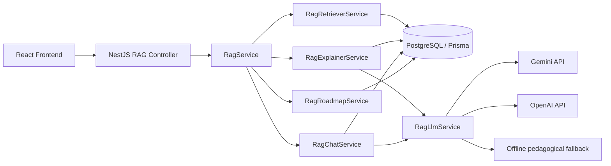
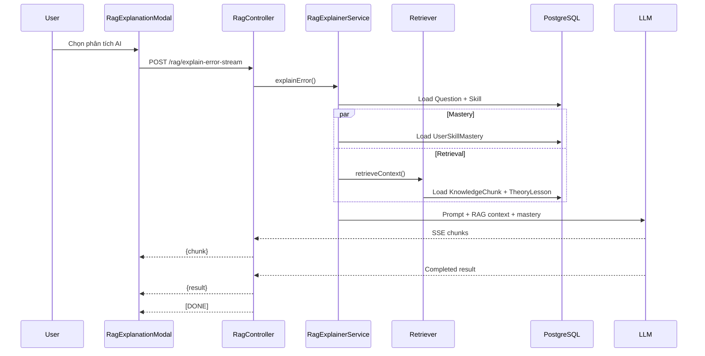
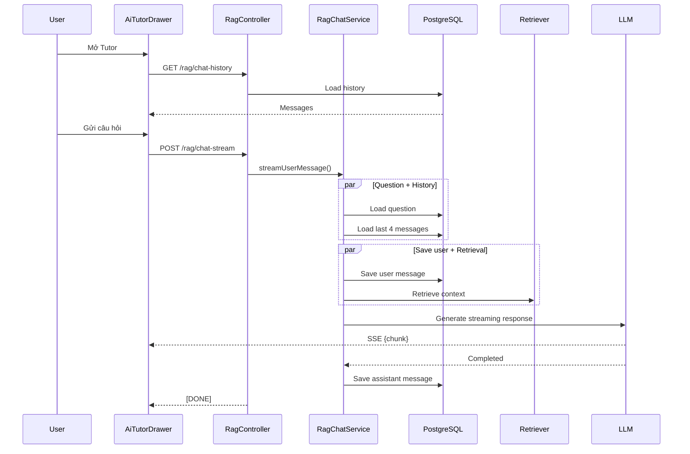

# Báo cáo kiến trúc và workflow RAG hiện tại

## 1. Kết luận tổng quan

Hệ thống hiện tại là một **lightweight RAG pipeline**, chưa phải RAG sử dụng embedding hoặc vector database.

Luồng chính:

1. Nhận câu hỏi/câu trả lời của học viên.
2. Truy vấn dữ liệu câu hỏi, kỹ năng và mastery từ PostgreSQL.
3. Truy xuất các `KnowledgeChunk` và `TheoryLesson` phù hợp.
4. Xếp hạng bằng luật/token overlap trong bộ nhớ.
5. Gửi ngữ cảnh đã truy xuất cùng prompt cá nhân hóa tới Gemini/OpenAI.
6. Trả kết quả dạng JSON hoặc streaming SSE.
7. Frontend hiển thị lời giải, lịch sử chat, nguồn tham chiếu và lộ trình học.



---

## 2. Các module và file chính

### Backend

| Thành phần | File tuyệt đối | Vai trò |
|---|---|---|
| Controller | `D:\NEU\KHOA_LUAN\toeic-adaptive\backend\src\rag\rag.controller.ts` | Định nghĩa REST/SSE endpoint, JWT guard, response streaming |
| Service façade | `D:\NEU\KHOA_LUAN\toeic-adaptive\backend\src\rag\rag.service.ts` | Điều phối explainer, chat, retriever và roadmap |
| DTO | `D:\NEU\KHOA_LUAN\toeic-adaptive\backend\src\rag\dto\rag.dto.ts` | Validate payload giải thích và chat |
| Retriever | `D:\NEU\KHOA_LUAN\toeic-adaptive\backend\src\rag\rag-retriever.service.ts` | Đọc, chấm điểm và chọn tri thức liên quan |
| Explainer | `D:\NEU\KHOA_LUAN\toeic-adaptive\backend\src\rag\rag-explainer.service.ts` | Sinh lời giải cá nhân hóa theo câu hỏi và mastery |
| Chat | `D:\NEU\KHOA_LUAN\toeic-adaptive\backend\src\rag\rag-chat.service.ts` | Chuẩn bị prompt, lưu lịch sử và streaming chat |
| LLM adapter | `D:\NEU\KHOA_LUAN\toeic-adaptive\backend\src\rag\rag-llm.service.ts` | Tích hợp Gemini/OpenAI, timeout, fallback, streaming |
| Roadmap | `D:\NEU\KHOA_LUAN\toeic-adaptive\backend\src\rag\rag-roadmap.service.ts` | Sinh lộ trình ưu tiên từ mastery và bài học lý thuyết |
| Module | `D:\NEU\KHOA_LUAN\toeic-adaptive\backend\src\rag\rag.module.ts` | Đăng ký các provider RAG |

### Frontend

| Thành phần | File tuyệt đối | Vai trò |
|---|---|---|
| Explanation modal | `D:\NEU\KHOA_LUAN\toeic-adaptive\frontend\src\components\rag\RagExplanationModal.tsx` | Hiển thị lời giải RAG dạng streaming |
| Tutor drawer | `D:\NEU\KHOA_LUAN\toeic-adaptive\frontend\src\components\rag\AiTutorDrawer.tsx` | Chat AI Tutor, lịch sử, streaming và abort |
| Floating button | `D:\NEU\KHOA_LUAN\toeic-adaptive\frontend\src\components\rag\AiTutorFloatingButton.tsx` | Mở AI Tutor toàn cục |
| Exam review integration | `D:\NEU\KHOA_LUAN\toeic-adaptive\frontend\src\pages\ExamReviewPage.tsx` | Gọi giải thích câu thi và hỏi Tutor theo câu |
| Adaptive practice integration | `D:\NEU\KHOA_LUAN\toeic-adaptive\frontend\src\components\AdaptivePracticeModal.tsx` | Gọi giải thích sau khi trả lời câu luyện tập |
| Roadmap UI | `D:\NEU\KHOA_LUAN\toeic-adaptive\frontend\src\components\recommendations\PriorityRoadmapSection.tsx` | Hiển thị lộ trình cá nhân hóa |
| Recommendations page | `D:\NEU\KHOA_LUAN\toeic-adaptive\frontend\src\pages\RecommendationsPage.tsx` | Tích hợp roadmap với adaptive practice |
| App integration | `D:\NEU\KHOA_LUAN\toeic-adaptive\frontend\src\App.tsx` | Hiển thị AI Tutor toàn cục, ngoại trừ phòng thi |
| API utility | `D:\NEU\KHOA_LUAN\toeic-adaptive\frontend\src\lib\api.ts` | Gọi REST API, gắn JWT |
| SSE utility | `D:\NEU\KHOA_LUAN\toeic-adaptive\frontend\src\lib\sse.ts` | Đọc SSE an toàn với UTF-8 fragmentation và cancellation |

---

## 3. Mô hình dữ liệu

Các model chính nằm trong:

`D:\NEU\KHOA_LUAN\toeic-adaptive\backend\prisma\schema.prisma`

### Dữ liệu câu hỏi và kỹ năng

```text
Question
   └── QuestionSkill
           └── Skill
```

`Skill` được dùng để:

- Xác định kỹ năng của câu hỏi.
- Truy xuất tri thức theo `skillCode`.
- Đọc `UserSkillMastery`.
- Xác định bài học lý thuyết tương ứng.

### Dữ liệu tri thức

#### `KnowledgeChunk`

Chứa các mẩu tri thức có cấu trúc:

- `part`
- `skillCode`
- `category`
- `title`
- `content`
- `keywords`
- `lessonId`

Đây là nguồn tri thức chính cho keyword-based retrieval.

#### `TheoryLesson`

Chứa các bài học lý thuyết:

- `title`
- `content`
- `part`
- `skillId`

Retriever có thể đưa cả `KnowledgeChunk` và `TheoryLesson` vào context. Roadmap sử dụng `TheoryLesson` để đề xuất bài học cho từng kỹ năng.

#### `UserSkillMastery`

Lưu trạng thái mastery cá nhân:

- `masteryScore`
- `practiceCount`
- `lastPracticed`

Dữ liệu này được dùng trong:

- Explanation personalization.
- Priority roadmap.
- Adaptive learning workflow.

#### `AiChatMessage`

Lưu lịch sử AI Tutor:

- `userId`
- `role`
- `content`
- `contextData`
- `createdAt`

Khi xóa lịch sử, hệ thống chỉ xóa các message của user hiện tại.

---

## 4. Retrieval hiện tại

File:

`D:\NEU\KHOA_LUAN\toeic-adaptive\backend\src\rag\rag-retriever.service.ts`

### Quy trình

1. Nhận:
   - `query`
   - `part`
   - `skillCode`
   - `topK`

2. Tokenize query:
   - Chuyển thành chữ thường.
   - Loại bỏ punctuation.
   - Bỏ token có độ dài dưới 2.
   - Giới hạn tối đa 80 token khác nhau.

3. Đọc candidate từ PostgreSQL:
   - `KnowledgeChunk`
   - `TheoryLesson`

4. Chấm điểm trong memory.

5. Sắp xếp giảm dần theo điểm và lấy `topK`.

### Công thức điểm cho `KnowledgeChunk`

| Điều kiện | Điểm |
|---|---:|
| Trùng `skillCode` | +50 |
| Trùng `part` | +20 |
| Keyword khớp token | +15 |
| Token xuất hiện trong title | +8 |
| Token xuất hiện trong content | +3 |

### Công thức điểm cho `TheoryLesson`

| Điều kiện | Điểm |
|---|---:|
| Trùng skill | +45 |
| Trùng part | +15 |
| Token xuất hiện trong title | +7 |
| Token xuất hiện trong content | +2 |

`TheoryLesson` chỉ được đưa vào kết quả nếu điểm lớn hơn 15.

### Giới hạn nội dung

- `KnowledgeChunk`: tối đa 2.400 ký tự.
- `TheoryLesson`: tối đa khoảng 1.000 ký tự.

### Cache

Retriever có cache process-local:

- Cache theo `part`.
- TTL 60 giây.
- Tối đa 16 part keys.
- Chia sẻ các request đang cùng tải dữ liệu.
- Nếu database read thất bại, cache entry bị xóa để request sau có thể thử lại.
- Không cache dữ liệu mastery, lịch sử chat hoặc câu trả lời cá nhân.

### Nhận định

Đây là **rule-based lexical retrieval**, không có:

- Embedding model.
- Cosine similarity.
- Vector database.
- Semantic search.
- Reranker bằng machine learning.

Với corpus nhỏ, cách này đơn giản và đủ dễ kiểm soát. Nếu corpus tăng lớn, truy vấn toàn bộ candidate rồi chấm điểm trong Node.js sẽ trở thành điểm nghẽn.

---

## 5. Workflow A — Giải thích câu trả lời

### Frontend flow

#### Exam review

Bắt đầu từ:

`D:\NEU\KHOA_LUAN\toeic-adaptive\frontend\src\pages\ExamReviewPage.tsx`

1. Frontend tải `/exam/:attemptId/review`.
2. Hiển thị từng câu hỏi và đáp án của học viên.
3. Người dùng chọn **“Phân tích chi tiết AI (RAG)”**.
4. Mở `RagExplanationModal`.
5. Modal gọi:

```text
POST /rag/explain-error-stream
```

Payload:

```json
{
  "questionId": 123,
  "selectedAnswer": "B"
}
```

6. Modal hiển thị text từng chunk.
7. Khi nhận event `result`, chuyển sang giao diện bốn phần.

#### Adaptive practice flow

Bắt đầu từ:

`D:\NEU\KHOA_LUAN\toeic-adaptive\frontend\src\components\AdaptivePracticeModal.tsx`

1. Lấy câu hỏi thích ứng qua `/das3h/adaptive-question`.
2. Gửi câu trả lời qua `/das3h/answer-adaptive`.
3. Hiển thị kết quả và cập nhật mastery.
4. Người dùng chọn **“Phân tích chi tiết AI (RAG)”**.
5. Tái sử dụng `RagExplanationModal`.

Giải thích RAG có thể được gọi cả khi học viên trả lời đúng, không chỉ khi trả lời sai.

### Backend flow

`RagExplainerService` thực hiện:

1. Tìm câu hỏi theo `questionId`, bao gồm skill.
2. Chọn skill đầu tiên làm `primarySkill`.
3. So sánh `selectedAnswer` với `correctAnswer`.
4. Đọc mastery cá nhân.
5. Chạy song song:
   - Query `UserSkillMastery`.
   - Retrieve `KnowledgeChunk` và `TheoryLesson`.
6. Xác định tone theo mastery:

| Mastery | Tone |
|---|---|
| `< 0.45` | Giải thích cơ bản, chi tiết, dịch và phân tích từng đáp án |
| `0.45–<0.70` | Phân tích bẫy và quy tắc trọng tâm |
| `>= 0.70` | Tập trung vào nuance, distractor và tốc độ làm bài |

7. Tạo prompt gồm:
   - Part.
   - Nội dung câu hỏi.
   - Bốn lựa chọn.
   - Đáp án đúng.
   - Đáp án học viên.
   - Giải thích có sẵn nếu có.
   - Mastery hiện tại.
   - Context RAG.

8. Gọi `RagLlmService`.
9. Tách output thành bốn section:

```text
1. Phân tích nguyên nhân chọn sai và bẫy tư duy
2. Phân tích cặn kẽ đáp án đúng
3. Quy tắc cốt lõi cần ghi nhớ
4. Lộ trình khắc phục đề xuất
```

10. Trả về:
    - Đáp án học viên.
    - Đáp án đúng.
    - `isCorrect`.
    - Mastery.
    - Explanation đầy đủ.
    - Bốn section.
    - Danh sách nguồn RAG.



---

## 6. Workflow B — AI Tutor Chat

### Frontend

`D:\NEU\KHOA_LUAN\toeic-adaptive\frontend\src\components\rag\AiTutorDrawer.tsx`

Khi drawer mở:

1. Gọi `GET /rag/chat-history`.
2. Hiển thị tối đa 30 message gần nhất.
3. Người dùng nhập câu hỏi.
4. Gọi:

```text
POST /rag/chat-stream
```

Payload có thể gồm:

```json
{
  "message": "Phân biệt although và despite",
  "questionId": 123,
  "skillCode": "P5_CONNECTORS_CONJ"
}
```

Frontend:

- Tạo message tạm cho user.
- Tạo assistant message rỗng.
- Nối từng `chunk` vào assistant message.
- Chặn gửi trùng khi request đang chạy.
- Abort request khi đóng drawer, đổi context hoặc unmount.
- Hiển thị text partial nếu connection bị gián đoạn.
- Không coi stream bị truncate là câu trả lời hoàn tất.

### Backend

`RagChatService.prepareChatPrompt()` thực hiện:

1. Tải song song:
   - Câu hỏi hiện tại nếu có.
   - Bốn message gần nhất của user.

2. Giới hạn mỗi message lịch sử ở 2.400 ký tự.

3. Lưu user message và retrieval được khởi động song song.

4. Truy xuất tối đa 3 tri thức dựa trên:
   - Nội dung message.
   - `skillCode`.
   - `part` của câu hỏi hiện tại.

5. Tạo prompt gồm:
   - Lịch sử hội thoại.
   - Nội dung câu hỏi TOEIC hiện tại.
   - Đáp án đúng và các lựa chọn.
   - Context RAG.
   - Câu hỏi mới.

6. Gọi LLM với:
   - Temperature: `0.5`.
   - Maximum tokens: `1.200`.

7. Streaming chat chỉ lưu assistant message sau khi generation hoàn tất.

Nếu stream bị lỗi hoặc bị hủy:

- User message đã lưu trước đó có thể vẫn tồn tại.
- Assistant partial message không được lưu như một câu trả lời hoàn chỉnh.



---

## 7. SSE và cancellation

Backend sử dụng SSE trong:

- `POST /rag/explain-error-stream`
- `POST /rag/chat-stream`

File:

`D:\NEU\KHOA_LUAN\toeic-adaptive\backend\src\rag\rag.controller.ts`

Header chính:

```text
Content-Type: text/event-stream; charset=utf-8
Cache-Control: no-cache, no-transform
Connection: keep-alive
X-Accel-Buffering: no
```

Backend gửi heartbeat mỗi 10 giây để tránh proxy đóng connection.

### Explanation event format

```text
data: {"chunk":"..."}

data: {"result":{...}}

data: [DONE]
```

### Chat event format

```text
data: {"chunk":"..."}

data: [DONE]
```

Frontend parser tại:

`D:\NEU\KHOA_LUAN\toeic-adaptive\frontend\src\lib\sse.ts`

có các đặc điểm:

- Hỗ trợ CRLF.
- Hỗ trợ UTF-8 tiếng Việt bị chia giữa các network frame.
- Phát hiện JSON lỗi.
- Phát hiện stream bị truncate.
- Cancel và release reader ở mọi exit path.
- Không coi response hoàn tất nếu thiếu `[DONE]`.

---

## 8. LLM provider và fallback

File:

`D:\NEU\KHOA_LUAN\toeic-adaptive\backend\src\rag\rag-llm.service.ts`

### Thứ tự provider

1. Gemini nếu có `GEMINI_API_KEY`.
2. OpenAI nếu có `OPENAI_API_KEY`.
3. Offline pedagogical fallback nếu không provider nào hoạt động.

### Cấu hình mặc định

| Biến | Giá trị mặc định |
|---|---|
| `GEMINI_MODEL` | `gemini-2.5-flash` |
| `OPENAI_MODEL` | `gpt-4o-mini` |
| `GEMINI_THINKING_BUDGET` | `0` |
| `LLM_FIRST_TOKEN_TIMEOUT_MS` | `8000` |
| `LLM_IDLE_TIMEOUT_MS` | `10000` |
| `LLM_TOTAL_TIMEOUT_MS` | `45000` |

### Retry và cooldown

- Gemini model bị `404` có thể thử model Flash ổn định.
- Không retry đối với quota, authentication, network hoặc overload error.
- Provider lỗi được cooldown 30 giây.
- Nếu provider đã phát một phần text rồi mới lỗi, hệ thống không nối thêm câu trả lời từ provider khác.
- Timeout thực sự abort upstream fetch.

### Offline fallback

Fallback được phân biệt theo loại request:

- Chat fallback.
- Explanation fallback.

Một số chủ đề được xử lý riêng như:

- `although` / `despite`.
- Bẫy lặp từ Part 2.
- Rút gọn mệnh đề quan hệ.
- Câu hỏi Not/True Part 7.

Fallback giúp hệ thống vẫn hoạt động khi không có API key hoặc provider không khả dụng, nhưng chất lượng không tương đương model thật.

---

## 9. Workflow C — Personalized Priority Roadmap

Endpoint:

```text
GET /rag/priority-roadmap
```

Frontend gọi endpoint tại:

`D:\NEU\KHOA_LUAN\toeic-adaptive\frontend\src\components\recommendations\PriorityRoadmapSection.tsx`

### Backend xử lý

`RagRoadmapService` tải song song:

1. Tất cả `Skill`.
2. `UserSkillMastery` của user.
3. Tất cả `TheoryLesson`.

Nếu user chưa có mastery record:

```text
masteryScore = 0.5
practiceCount = 0
```

### Phân loại ưu tiên

| Mastery | Priority | Estimated gain |
|---|---|---:|
| `< 0.45` | `P0_CRITICAL` | 25 |
| `0.45–<0.65` | `P1_FOCUS` | 15 |
| `>= 0.65` | `P2_ADVANCED` | 5 |

Roadmap được sắp xếp:

1. P0 trước.
2. P1 tiếp theo.
3. P2 cuối cùng.
4. Trong cùng priority, mastery thấp hơn đứng trước.

Mỗi step có:

- Skill.
- Part.
- Mastery.
- Practice count.
- Priority label.
- Action text.
- Recommended theory lesson.
- Estimated point gain.

### Frontend sử dụng

`RecommendationsPage`:

1. Tải hồ sơ `/mastery/me`.
2. Tải roadmap riêng qua `/rag/priority-roadmap`.
3. Hiển thị tối đa 15 roadmap steps.
4. Cho lọc P0/P1/P2.
5. Nút **“Luyện tập ZPD”** mở `AdaptivePracticeModal`.
6. Khi làm xong, reload lại mastery profile.

Lưu ý: roadmap không gọi LLM và không sử dụng trực tiếp `KnowledgeChunk`; đây là module cá nhân hóa dựa trên mastery, có liên kết tới `TheoryLesson`.

Nút bài học hiện chỉ điều hướng tới:

```text
/theory
```

chứ chưa điều hướng trực tiếp tới lesson ID cụ thể.

---

## 10. Các endpoint RAG

Tất cả endpoint nằm dưới JWT guard trong:

`D:\NEU\KHOA_LUAN\toeic-adaptive\backend\src\rag\rag.controller.ts`

| Method | Endpoint | Mục đích |
|---|---|---|
| `POST` | `/rag/explain-error` | Explanation dạng JSON |
| `POST` | `/rag/explain-error-stream` | Explanation dạng SSE |
| `POST` | `/rag/chat` | Chat dạng JSON |
| `POST` | `/rag/chat-stream` | Chat dạng SSE |
| `GET` | `/rag/chat-history` | Lấy lịch sử chat |
| `DELETE` | `/rag/chat-history` | Xóa lịch sử chat |
| `GET` | `/rag/priority-roadmap` | Lấy roadmap cá nhân |
| `GET` | `/rag/knowledge/search` | Tìm kiếm knowledge theo query/part |

Frontend hiện chủ yếu sử dụng hai endpoint streaming:

- `/rag/explain-error-stream`
- `/rag/chat-stream`

Các endpoint JSON vẫn được giữ để tương thích hoặc dùng cho integration khác.

---

## 11. Seed và điều kiện runtime

### Seed tri thức

File:

`D:\NEU\KHOA_LUAN\toeic-adaptive\backend\prisma\seed-knowledge.ts`

Script:

```text
D:\NEU\KHOA_LUAN\toeic-adaptive\backend\npm run seed:knowledge
```

Script:

- Tìm skill theo `skillCode`.
- Tạo hoặc cập nhật `TheoryLesson`.
- Tạo hoặc cập nhật `KnowledgeChunk`.
- Không tạo duplicate dựa trên `title + part`.
- Bỏ qua lesson nếu skill tương ứng chưa tồn tại.
- In tổng số lesson/chunk sau khi seed.

Do đó, thứ tự triển khai nên là:

1. Chạy migration.
2. Seed skills.
3. Seed knowledge.
4. Chạy backend.

### Database và service phụ thuộc

- PostgreSQL chứa toàn bộ dữ liệu câu hỏi, mastery, knowledge và chat.
- Redis được cấu hình cho BullMQ/mastery queue trong `D:\NEU\KHOA_LUAN\toeic-adaptive\backend\src\app.module.ts`.
- Backend config nằm tại `D:\NEU\KHOA_LUAN\toeic-adaptive\backend\src\config\environment.ts`.
- Frontend mặc định gọi `http://localhost:3000` nếu không có `VITE_API_URL`.

File:

`D:\NEU\KHOA_LUAN\toeic-adaptive\backend\.env`

hiện có cấu hình database, JWT và Gemini. API key không nên commit vào repository; nếu key hiện tại đã từng bị đưa lên repository hoặc chia sẻ công khai, cần rotate key.

---

## 12. Kiểm tra và xác minh

Kết quả xác minh hiện tại:

### Backend

- Full test suite: **84 tests passed**
- Test suites: **19 passed**
- Build: **pass**
- Oxlint: **0 warnings, 0 errors**

Các test RAG chính:

- `D:\NEU\KHOA_LUAN\toeic-adaptive\backend\src\rag\rag-llm.service.spec.ts`
- `D:\NEU\KHOA_LUAN\toeic-adaptive\backend\src\rag\rag-retriever.service.spec.ts`
- `D:\NEU\KHOA_LUAN\toeic-adaptive\backend\src\rag\rag-roadmap.service.spec.ts`
- `D:\NEU\KHOA_LUAN\toeic-adaptive\backend\src\rag\rag-streaming.spec.ts`

RAG-specific coverage gồm:

- Provider fallback.
- Model fallback.
- Timeout.
- Cooldown.
- UTF-8/SSE fragmentation.
- Reader cleanup.
- Cancellation.
- Partial stream failure.
- Retrieval cache.
- Cache expiration.
- Concurrent retrieval.
- Chat persistence.
- Roadmap priority.

### Frontend

- Tests: **24 passed**
- Production build: **pass**
- ESLint: **pass**

Các test frontend chủ yếu kiểm tra:

- Exam session state.
- Local storage.
- SSE parser.
- UTF-8 fragmentation.
- `[DONE]`.
- Truncated stream.
- Server error sau partial text.
- Response body bị thiếu.

### Live provider

Các kiểm tra provider trực tiếp trước đó cho thấy Gemini có lúc trả HTTP `503`. Vì vậy:

- Unit test provider sử dụng mock.
- Build/test không chứng minh provider production đang hoạt động ổn định.
- Chất lượng câu trả lời thực tế và latency thành công vẫn cần kiểm tra trên môi trường triển khai thật.
- Chưa chạy browser E2E thực tế.

---

## 13. Các giới hạn và rủi ro cần báo cáo

### 13.1. Retrieval chưa có semantic search

Hệ thống hiện dùng keyword/token overlap. Các trường hợp diễn đạt khác từ khóa trong database có thể bị xếp hạng thấp hoặc không retrieve được.

### 13.2. Corpus còn nhỏ

Retriever đang load candidate từ PostgreSQL rồi xếp hạng trong Node.js. Khi số lượng knowledge tăng lớn, nên chuyển sang:

- PostgreSQL full-text search.
- `pgvector`.
- Vector database.
- Hoặc hybrid retrieval có embedding.

### 13.3. Roadmap chọn lesson đơn giản

Roadmap tạo `lessonMap` theo `skillId`. Nếu một skill có nhiều lesson, lesson được đặt sau cùng trong kết quả query có thể ghi đè lesson trước đó.

### 13.4. Anti-cheating boundary chưa đầy đủ

Theo kiểm tra hiện tại, các endpoint RAG đã yêu cầu JWT nhưng:

- Explanation/chat nhận `questionId`.
- Explainer và chat đưa `correctAnswer` vào model context.
- Chưa kiểm tra user có đang thuộc một exam attempt hợp lệ hay không.

Do đó, nếu mục tiêu là ngăn truy cập đáp án trong thời gian thi, cần thiết kế thêm authorization theo exam attempt và trạng thái bài thi.

### 13.5. API key trong `.env`

File:

`D:\NEU\KHOA_LUAN\toeic-adaptive\backend\.env`

đang chứa Gemini API key. Không nên để secret thật trong Git hoặc tài liệu báo cáo.

### 13.6. Không hoàn tác được server-side work khi frontend abort

Abort giúp ngăn UI cập nhật stale response và hủy upstream generation, nhưng nếu server đã lưu user message hoặc đã commit một thao tác trước thời điểm abort thì frontend không thể hoàn tác transaction đó.

---

## 14. Đoạn tóm tắt dùng trong báo cáo supervisor

> Hệ thống AI Tutor hiện thực một kiến trúc RAG nhẹ trên nền NestJS, PostgreSQL và React. Thay vì sử dụng embedding hoặc vector database, hệ thống truy xuất `KnowledgeChunk` và `TheoryLesson` từ PostgreSQL, sau đó xếp hạng bằng luật kết hợp skill matching, TOEIC part matching, keyword matching và token overlap. Có hai workflow chính: giải thích câu trả lời cá nhân hóa dựa trên câu hỏi, đáp án học viên, mastery DAS3H và tri thức liên quan; và AI Tutor chat sử dụng lịch sử hội thoại, ngữ cảnh câu hỏi và knowledge context. Kết quả được sinh qua Gemini hoặc OpenAI, có offline fallback, timeout, provider cooldown và SSE streaming. Frontend hỗ trợ hiển thị câu trả lời theo từng chunk, cancellation, retry và bảo vệ khỏi stale response. Ngoài ra, hệ thống có personalized priority roadmap dựa trên mastery của từng skill và liên kết tới bài học lý thuyết. Các test backend, frontend, build và lint đều đã vượt qua; tuy nhiên semantic retrieval, browser E2E, chất lượng live LLM và authorization chống truy cập đáp án trong thời gian thi vẫn là các hạng mục cần tiếp tục hoàn thiện.

Trong phiên kiểm tra này không có file mã nguồn nào được chỉnh sửa. Workspace vẫn chứa các thay đổi và file mới tồn tại từ trước, bao gồm thư mục RAG và các thành phần liên quan.